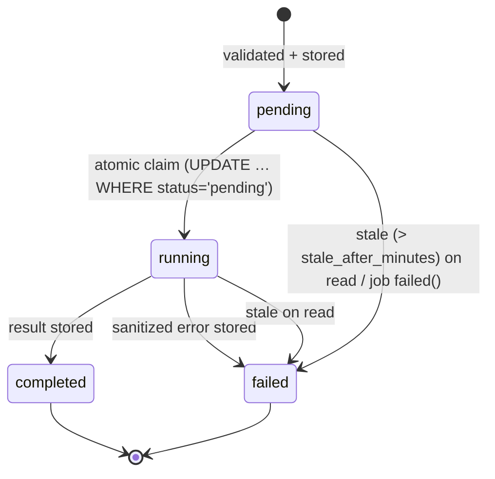

# Phase A — Analysis run API contract

Status: **implemented and tested** (2026-10-27). Code: `app/Http/Controllers/AnalysisRunController.php` and `app/Services/Tools/*`. Tests: `tests/Feature/AnalysisRunApiTest.php`, `AnalysisRunServiceTest.php` and `WebsiteAnalyzerPilotTest.php`.

## 0. Compatibility: the legacy contract is unchanged

`POST /api/tools/{slug}` (all 46 tools) keeps its exact request and response shape. Verified for `website-analyzer` by a golden fixture captured *before* the refactor (`tests/fixtures/website-analyzer-pilot.json`), and for the other tools by the existing `ToolsApi*` test suites, which are all green.

| Legacy behaviour (from `ToolsApiController::handle`) | Shape |
|---|---|
| Success | `200` + the tool payload directly, e.g. `{score, grade, passed, stats, issues, checks, recommendations, scoringMethod, confidence, analyzedUrl, executionTimeMs, fromCache, analyzedAt, …}` |
| Unknown slug | `404 {"error":"Tool not found"}` |
| Missing or unsafe URL | `422 {"error":"The submitted URL could not be analyzed. …"}` |
| Provider not configured | `503 {"error", "reason":"missing_api_credentials", "provider", "requiredEnv", "documentation", "note"}` |
| Any other failure | `500 {"error":"Analysis failed. …"}` |
| Rate limit | `429` (limiter `tools-api`: 20/min per IP, 5/min for `HEAVY_TOOLS`) |

The run API is a **separate, versioned** surface. It never changes the responses above.

## 1. Which tools are available

Only the slugs whitelisted in `config/analysis.php → tools` are accepted. In Phase A that is just **`website-analyzer`**. Any other slug, including legacy tools, returns `404 unknown_tool`.

## 2. Start a run

`POST /api/v2/tools/{slug}/runs`

- Body: JSON. The fields are tool-specific (`website-analyzer`: `{"url": "https://example.com"}`). Unknown fields are ignored and **never stored**; only the tool's normalised input is persisted.
- Middleware: `throttle:tools-api`. This is the **same** limiter and keys as the legacy endpoint, so one budget is shared, not doubled.
- Bodies over 16 KB are refused with 413.

### 201: completed synchronously

```json
{
  "run": {
    "id": "7340c10a-870d-47df-aa9a-4bc8726a1143",
    "tool": "website-analyzer",
    "mode": "sync",
    "status": "completed",
    "progress": null,
    "stage": null,
    "createdAt": "2026-10-27T14:21:28+00:00",
    "startedAt": "2026-10-27T14:21:28+00:00",
    "completedAt": "2026-10-27T14:21:31+00:00",
    "expiresAt": "2026-11-26T14:21:31+00:00"
  },
  "result": { "score": 47, "grade": "D", "checks": [ … ], "stats": { … }, "analyzedUrl": "https://example.com/", … },
  "error": null,
  "accessToken": "pX3…48 chars…"
}
```

The `Location` header is `/api/v2/runs/{id}`. `result` is **identical** to the legacy endpoint's payload; a test asserts this. `progress` is `null` because the analysis pipeline cannot measure granular progress, so no percentage is invented.

### 202: queued (only for tools declared `queued`, with `ANALYSIS_QUEUE_ENABLED=true`)

Same envelope, with `run.status: "pending"`, `result: null` and `accessToken`. Poll `GET /api/v2/runs/{id}`.

### Errors

Errors use the shape `{"error": {"code", "message", …}}`. Messages are fixed, user-safe French strings and never contain exception text.

| HTTP | `error.code` | When | Run stored? |
|---|---|---|---|
| 404 | `unknown_tool` | slug not whitelisted, or path tricks (the slug must match `[a-z0-9-]+`) | no |
| 413 | `payload_too_large` | body > 16 KB | no |
| 422 | `invalid_input` (+ `error.fields`) | the tool's validation rules failed (`website-analyzer`: `url` required, string, ≤ 2048 characters) | no |
| 422 | `unsafe_url` | SSRF gate: private, loopback, link-local, CGNAT or metadata IPs (v4 and v6), alternate IP encodings, credentials in the URL, non-80/443 ports, non-http(s) schemes | no |
| 503 | `queue_unavailable` | the tool needs a background worker, none is enabled, and the tool forbids inline execution | no |
| 422 | `unsafe_url` | URL accepted, but a **redirect** led to a private address during the fetch | yes, `failed` |
| 503 | `provider_unavailable` | a third-party provider is not configured | yes, `failed` |
| 502 | `analysis_failed` | the target site or an upstream service failed | yes, `failed` |
| 429 | — | rate limit (`tools-api`) | no |

When a run is stored as failed, the response includes the run envelope with `run.status: "failed"`, `result: null` and the `error` object.

## 3. Read a run

`GET /api/v2/runs/{id}`, with the token in the `X-Run-Token: <accessToken>` header or the `?token=<accessToken>` query parameter. The query form allows a shareable link, but it can appear in server access logs and `Referer` headers, so clients should prefer the header. The pilot page always uses the header.

- Middleware: `throttle:analysis-runs-read` (60/min per IP, a separate bucket).
- Response: `200` with the same envelope as creation, **without** `accessToken`, plus `Cache-Control: no-store, private`.
- `result` is present only when `completed`; `error` only when `failed`.

### Authorisation

| Requester | Access |
|---|---|
| Holder of the run's access token | ✅ |
| Authenticated owner (`user_id` matches) | ✅ (service level, see below) |
| Anyone with only the UUID | ❌ 404 |
| Another run's token, or a wrong or truncated token | ❌ 404 |
| Authenticated user who is not the owner, without a token | ❌ 404 |

"Not found" and "not yours" return the **same** `404 run_not_found` response, so run IDs cannot be enumerated. Tokens are 48 random characters. Only their SHA-256 is stored, and comparison uses `hash_equals`.

> **Phase A limitation (by design).** API routes are stateless: no session or Sanctum guard is attached, and the site has no customer accounts yet. Through HTTP, every run is therefore anonymous and token-protected. Owner-based access is implemented in `AnalysisRunService::canAccess()` and covered by unit tests, so it will work as soon as Phase G adds a customer guard.

## 4. Status lifecycle



- **Exactly-once execution.** `claim()` is an atomic conditional update, so a retried or duplicated job is a no-op once the run is no longer pending. `RunToolJob` has `$tries = 1`.
- **No late overwrite.** `markCompleted()` only applies to a `running` run, so a completion arriving after a timeout cannot overwrite `failed`.
- **Never stuck.** A `pending` or `running` run older than `ANALYSIS_STALE_AFTER_MINUTES` (default 15) is reported `failed / run_timeout` on read. The job's `failed()` hook also marks the run failed.

## 5. Retention

`expires_at` is set at creation: 30 days for anonymous runs and 365 days for user runs (`ANALYSIS_RETENTION_*`). Expired runs are deleted by `php artisan analysis:prune-runs` (`--dry-run` available), which is scheduled daily in `routes/console.php`. This needs `schedule:run` from cron.

## 6. Configuration (`config/analysis.php`)

| Env | Default | Meaning |
|---|---|---|
| `ANALYSIS_QUEUE_ENABLED` | `false` | Leave off on Hostinger shared hosting (no worker) |
| `ANALYSIS_QUEUE_CONNECTION` | (default connection) | Queue connection for `RunToolJob` |
| `ANALYSIS_QUEUE_NAME` | `analysis` | Queue name; the worker must listen on it |
| `ANALYSIS_STALE_AFTER_MINUTES` | `15` | Timeout for pending or running runs |
| `ANALYSIS_RETENTION_ANONYMOUS_DAYS` | `30` | — |
| `ANALYSIS_RETENTION_USER_DAYS` | `365` | — |

## 7. Adding a tool

1. Implement `App\Services\Tools\AnalysisTool`:
   - `slug()` and `mode()`
   - `allowsInlineFallback()`
   - `rules()`
   - `normalizeInput()`, which **must** run `SafeUrlValidator` for URL inputs
   - `run($input, $progress)`, which reports **measured** progress only
2. Register it in `config/analysis.php → tools`.
3. Add it to `RUN_API_TOOLS` in `public/js/tools/api-tools.js` if its page uses the shared renderer.
4. Tests: copy the patterns in `AnalysisRunApiTest` (contract, validation, SSRF, auth) and add a golden fixture if a legacy endpoint exists.
