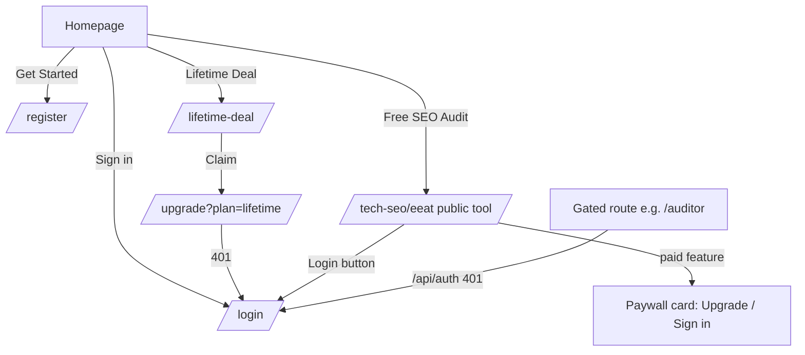

# Workflow: Discovery → tool → sign-up, and the authentication boundary

**Reference URLs:** `/`, `/lifetime-deal`, `/login`, `/register`, any gated route (e.g. `/auditor`, `/dashboard`)
**User objective:** understand the product, try a tool, then create an account or buy.

## A. Marketing funnel (observed)

1. **Homepage `/`.** Fixed header: logo, Features (`/#features`), Lifetime Deal, Pricing (`/#pricing`), Help (`/#faq`), Desktop App (`/#cta`), **Free SEO Audit** (→ `/tech-seo/eeat`), Sign in, **Get Started** (→ `/register`).
   Sections in order: hero ("Master the AI Search with Semantic Intelligence") with an animated dashboard mock; an "Inspired by global search experts" logo marquee; a live E-E-A-T audit demo (`#audit`); stat counters (819+ marketers, 4.2M+ sites audited, 312% avg lift, 27 awards — **marketing claims, not verified**); the feature grid (`#features`); a problem/solution comparison; "From Insight to Impact in 3 steps"; testimonials; pricing (`#pricing`) with a Monthly/Yearly toggle; a lifetime-deal banner; FAQ (`#faq`, 6 questions); the CTA "Ready to dominate AI search?" (`#cta`); and a footer with a newsletter field.
   Screenshot: `01-homepage/home-desktop-full.png`, mobile `09-mobile/home-mobile.png`.
2. **Pricing (observed):**

   | Plan | Monthly | Yearly (per month) | Highlights |
   |---|---|---|---|
   | Free | $0 | $0 | 1 website project, core on-page/technical tools, basic backlink directory, encyclopedia. Marked ✕ (excluded): saved audits & AI generation, Bing/GSC integrations, priority support |
   | Professional ("Most popular") | $19 | $16 ("Save $38") | 10 projects, saved audits & reports, full backlink database, AI content generation, Bing & GSC, priority email |
   | Enterprise | $49 | $41 ("Save $98") | Unlimited projects, team workspaces, advanced exports, API access, agency reporting & billing portal, 24/7 support |
   | Lifetime Deal | US$300 one-time | — | "80+ SEO tools and 11 courses" |

   Screenshots: `07-pricing/home-pricing-monthly-desktop.png`, `07-pricing/home-pricing-yearly-desktop.png`, `07-pricing/lifetime-deal-desktop-full.png`.
3. **`/lifetime-deal`:** a long sales page with 7 featured tools, 11 courses (named instructor, hours, lecture counts) and a complete feature list in 7 groups, which is the best public catalogue of the gated features. CTA → `/upgrade?plan=lifetime`, which redirects to login.

## B. Tool trial (observed)

1. "Free SEO Audit" → `/tech-seo/eeat` opens the **app shell without login**: a left icon rail with 12 sections, a section sidebar, and a top bar with *Select website*, breadcrumbs, *Patches 0*, *Share report*, *Search check points…*, a theme toggle and **Login**.
2. 78 tool or content routes render like this for anonymous users (see [route-inventory.md](../route-inventory.md)). Some run fully (E-E-A-T, Crawl Optimization, AI Model Checker, Keyword Suggest, utilities). Others show a paywall card ("Semantic Content Writer is a paid feature … Upgrade to unlock · Sign in"), a "Connect Search Console" card (GSC keyword reports) or a silent AI fallback (workflow 04).

## C. Authentication boundary (observed)

| Route group | Anonymous behaviour |
|---|---|
| `/dashboard`, `/auditor/*` (30), `/brand-radar/*` (16), `/gsc/*`, `/settings/*`, `/onboarding`, `/upgrade`, `/mcp`, `/lms/*` | Full-screen "Loading…" spinner, then a client-side redirect to `/login` (60 routes) |
| Every page | `GET /api/auth` → 401 (console error) |

- **`/login`:** "Welcome back". Continue with Google; email + password (both `required`); Remember me; Forgot password?; Sign in. A right-hand promo panel shows "60+ audit checks · 50+ SEO tools · 312% avg lift".
- **`/register`:** Sign up with Google; Full name (placeholder "Aleem Khan"); email; password with the hint "10+ characters, number & symbol"; confirm password with a show/hide toggle; Create account.
- **Not done:** no credentials were submitted, no account was created and no password-reset was requested (see the methodology).

## Development implications

- Keep the **"try before signup" pattern**: the core audits run anonymously, which converts well, but give each tool its own SSR landing page (which the reference lacks).
- Gate at the server (middleware), not with a client spinner and redirect.
- Pricing anchors: competitive SaaS pricing is about $19–$49/mo plus a lifetime deal. Our pricing is a business decision (DR-4).
