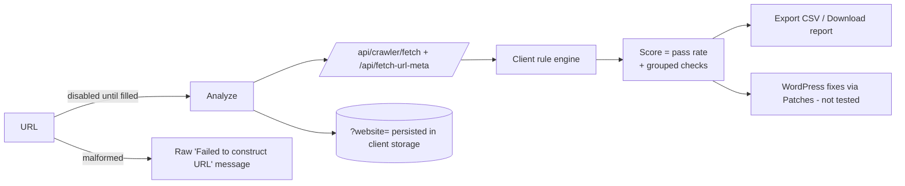

# Workflow: Technical and on-page audits (E-E-A-T, Crawl Optimization, Robots.txt Analyzer, Security Audit, On-Page Analyzer, Page SEO)

**Reference URLs and features:**

- `/tech-seo/eeat` (FEATURE-020)
- `/tech-seo/crawl` (-023)
- `/tech-seo/robots` (-022)
- `/tech-seo/security` (-027)
- `/on-page/analyzer` (-040)
- `/on-page/page-seo` (-041)

**User objective:** run a one-URL audit and get a score, a prioritised issue list and evidence.

## Shared flow (observed on all six tools)

1. Open the tool. The URL bar has a globe icon. The primary button (orange gradient, 120×40, radius 12) and "Export CSV" / "Export Report" sit on the right.
2. With the field empty, the primary button is **disabled** (TEST empty = `action-disabled-until-input`, PASS).
3. Enter `https://example.com` and click **Analyze** / **Run Audit** / **Analyze URL**.
4. Network: `GET /api/crawler/fetch` (one or more) plus `/api/fetch-url-meta`. Results render in about 3 s.
5. The app writes the site into its context: the header selector shows `example.com`, a "Local" or "Project" chip appears and the URL gains `?website=example.com`. **This state persists in client storage across tools.** It is restored on the next visit, which is why the test harness uses a fresh browser per case.
6. Result header: favicon/initial chip, domain, "Analyzed", **Re-analyze**, and (on some tools) "View Page Source · 0.6 KB", "Download Report", "Open page" and "Apply Recommended Fixes" (WordPress).
7. Malformed input `not a url ::` → the raw JavaScript exception text **"Failed to construct 'URL': Invalid URL"** (E-E-A-T, Crawl). It is rejected, but the message is a developer error string (UX defect).

## Per-tool output (observed on example.com)

| Tool | Score | Structure |
|---|---|---|
| E-E-A-T Audit | **31/100**; Passed 21 · Failed 47 · Unknown 1 · Automated 69 | Radar (E/E/A/T); 9 groups (see data-model §2.1); rows with ✓/✗/? icon + finding pill; some rows have a 🔑 (WordPress fix) |
| Crawl Optimization | **90/100 GOOD**, "27 of 30 checks clean" | Issues by severity (High / Medium / Low / Clean); "By area": Unnecessary Metadata 7, Feed Links 10, Scripts & Styles 2, Redirect Optimizations 2, Indexability & Crawlability 9; Crawl overview cards (crawl status, HTML status, load time 6 ms, HTML size 0.6 KB, links, resources, sitemaps, word count 25 "Thin"); a check table paginated "Showing 1–12 of 30" with a severity tag, rationale, area, location (Head / Body / HTTP header) and finding |
| Robots.txt Analyzer | **11% POOR**, "2 of 19 checks passed — 1 critical rule missing" | Critical callout (HTTP 404 → "Robots.txt Accessible: Not Found"); Potential issues 17; protected resources; crawler directives; issues list by severity; raw-file viewer (Copy / Download / Open live) |
| Security Audit | **27 CRITICAL**, "4 of 15 scored checks passed"; Passing 4 · Failing 11 · Skipped 5 | WordPress Hardening (9 checks: X-Powered-By, generator meta, xmlrpc.php, user enumeration pass; 5 "Requires server-side access" skipped); 11 security headers "Missing"; Raw Security Headers for 3 URLs: `/`, `/search/apple/`, `/?s=apple` |
| On-Page Analyzer | **28, GRADE E**, "50 of 70 checks need work" | See [SPEC-04](../agent-implementation-specs/SPEC-04-on-page-analyzer.md) §4 |
| Page SEO | **Page Health Score 3/10 (30%)** | 10 evidence-based checks (one descriptive title, meta length, exactly one H1, canonical, indexable, image alt, content depth, internal linking, OG, no mixed content); a GSC panel (Clicks/Impressions/CTR/Position "Connect Google Search Console"); a "Page Card" with editable patch drafts (Title, Description, Image Alt, Schema, Internal Links, Headings, Content) and an Activity Log |

## Inferred scoring

| Tool | Displayed | Fits | Status |
|---|---|---|---|
| E-E-A-T | 31 | 21 / (69 − 1 unknown) = 30.9 | Inferred, one observation |
| Robots | 11% | 2 / 19 = 10.5 | Inferred, one observation |
| Crawl Optimization | 90 | 27 / 30 | Inferred, one observation |
| Security | 27 | 4 / 15 = 26.7 | Inferred, one observation |
| Page SEO | 30% | 3 / 10 | Matches the displayed ratio |

All five are consistent with an **unweighted pass rate over scored checks**. Confirm on a second site before relying on it (README → Next investigations).

## Security Audit: active probing note

**Observed:** the audit requests `/search/apple/` and `/?s=apple` and checks `xmlrpc.php` and user enumeration on whatever domain is entered. **Development implication:** limit active probes (anything beyond fetching the page and its headers) to **verified-owned projects**, using DNS TXT or a file token, to avoid sending vulnerability-style probes to third-party sites (R-07, SPEC-15).

## Screenshots

`06-tool-results/tech-seo-eeat-valid-desktop.png`, `tech-seo-crawl-valid-desktop.png`, `tech-seo-robots-valid-desktop.png`, `tech-seo-security-valid-desktop.png`, `on-page-analyzer-valid-desktop.png`, `on-page-page-seo-valid-desktop.png`; malformed: `10-errors-and-empty-states/tech-seo-eeat-malformed-desktop.png`.

## Development implications

- One shared `AuditReport` view (score + counters + grouped checks + export) covers all six tools. Build it once in SPEC-01.
- Persisting the last site is useful (it feeds the "project" context), but make it explicit ("Switch site") and server-side for logged-in users.
- Show friendly validation messages, and never expose exception strings.
