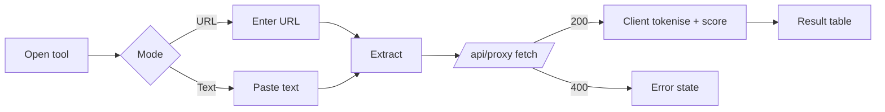

# Workflow: Content extraction (NLP Keywords, N-Grams, Entities Extractor)

**Reference URLs:** `/content/nlp`, `/content/ngrams`, `/content/entities-extractor` (features FEATURE-070, -071, -072)
**User objective:** pull the key phrases, n-grams or entities out of a competitor page or a pasted text, to inform semantic coverage.
**Starting state:** anonymous visitor in the app shell. Nothing is pre-filled. The mode tabs are **URL** | **Text** (Entities adds a *Competitor URLs* list with **Add URL**).
**Required inputs:** a URL (default mode) or text. N-Grams adds a "Live extraction" toggle.

## Steps (observed)

1. Open the tool. Screenshot: `screenshots/05-tool-inputs/content-nlp-input-desktop.png`.
2. Enter `https://example.com` in the URL field (placeholder `https://example.com/article`).
3. Click **Extract NLP** / **Extract**. On Entities the button is **disabled until a URL is entered** (TEST empty case = `action-disabled-until-input`). On NLP and N-Grams the button stays enabled, and an empty submit renders an empty table ("NLP Keywords (0)").
4. The browser calls `GET /api/proxy?…` (200), which returns the page HTML. **Extraction runs client-side** in under 3.1 s.
5. Result table:
   - NLP: `NLP Keywords (15)` with columns **KEYWORD · RELEVANCE · TYPE · SENTIMENT**. Every row on example.com was typed `Concept` / `Neutral`. Relevance ran 100% for unigrams and phrases and 52% for bigrams.
   - N-Grams: tabs `1-gram (12) · 2-gram (11) · 3-gram (10)` with columns **N-GRAM · COUNT · DENSITY**. Density = count / total tokens: 1/12 = 8.33% on example.com.
   - Entities: `Extracted Entities (7)` with columns **ENTITY · TYPE · SALIENCE · MENTIONS**. Every row was typed `Concept` with salience `1.00`.
6. Malformed URL `not a url ::` → `/api/proxy` returns **400** and the result area shows an error (TEST `validation-or-error (api /api/proxy=400)`).

## Observed output (example.com)

Stop-words are removed. Phrases come from adjacent content words ("avoid relying", "documentation examples without", "needing permission"). Types and sentiment do not vary.
**Inferred:** this is lightweight heuristic tokenisation, not a trained NER/NLP model. The evidence is uniform `Concept`/`Neutral`/`1.00` values and phrase boundaries that cut across sentences ("service avoid", "relying testing").

## Validation and error handling

| Case | Behaviour |
|---|---|
| Empty | Entities: button disabled. NLP/N-Grams: empty table with a (0) count. |
| Malformed URL | Proxy 400 → error state |
| Unreachable site | Not verified (no test against a dead host) |

## Navigation transitions

None. The results render in place and there is no share link for anonymous users.

## Screenshots

`05-tool-inputs/content-nlp-input-desktop.png`, `06-tool-results/content-nlp-valid-desktop.png`, `06-tool-results/content-ngrams-valid-desktop.png`, `06-tool-results/content-entities-extractor-valid-desktop.png`, `10-errors-and-empty-states/content-nlp-malformed-desktop.png`

## Unverified behaviour

- Behaviour in Text mode was not run.
- Competitor-URL comparison in Entities was not run with more than one URL.
- Whether logged-in users get a different (model-based) extraction is not verified.

## Development implications

- This is easy to beat. Do server-side fetching and extraction (PHP) with proper sentence segmentation, a multilingual stop-word list (we serve FR/EN/AR audiences) and TF-IDF against a background corpus. Entity typing can optionally use an LLM or Google Cloud NL (*Decision required*, DR-3).
- Return one shared `TextAnalysis` result reused by NLP, N-Grams and Entities so the three tools are one engine with three views.
