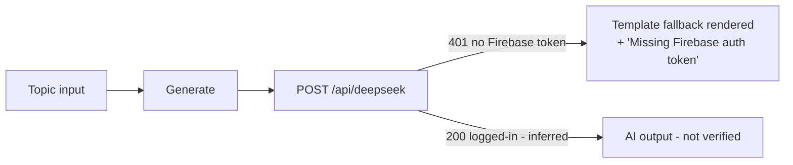

# Workflow: AI generation tools (Grammar, Skip-Gram, Unique N-Grams, Entities Generator, Outline Creator, AI Helper)

**Reference URLs:** `/content/grammar`, `/content/skip-gram`, `/content/unique-ngrams`, `/content/entities-generator`, `/content/outline`, `/content/ai-helper` (FEATURE-073 to -077)
**User objective:** generate semantically related vocabulary, n-grams, entities or a merged outline for a topic.
**Starting state:** anonymous visitor. Topic tools show example chips ("Laptop, Coffee, Marketing…", "bank, python, cloud…", "hot water benefits…").

## Steps (observed)

1. Enter a topic (`Laptop`, `bank`, `laptop maintenance`) or keywords (`semantic seo\ntechnical seo`). For Outline, enter source URLs.
2. Click **Generate** / **Generate Entities** / **Extract + AI Combine**.
3. The browser calls `POST /api/deepseek`, which returns **401**. The page shows the message **"Missing Firebase auth token"**.
4. The UI **still renders results**, and they are deterministic templates built from the input:
   - Grammar ("Laptop"): `37 words across 8 categories`: PROPER NOUNS (Laptop Research, Laptop Institute…), COMMON NOUNS (laptop tool, laptop method…), SYNONYMS, ANTONYMS (non-laptop, manual laptop…), HYPONYMS, HYPERNYMS (marketing, optimization…), MERONYMS (workflow, checklist…), HOLONYMS. Has *Copy all* per group and *Export All*.
   - Skip-gram ("bank"): bank context, bank meaning, bank intent… definition, attribute, entity, topic, query, document, ranking, semantic.
   - Unique n-grams ("laptop maintenance"): 8 numbered phrases ("…for neglected intents", "…with measurable proof", "…without keyword stuffing").
   - Entities generator: per keyword, 15 related entities ("semantic seo guide/tools/strategy/examples/benefits/risks/workflow/checklist").
   - Outline: the H1 is extracted from the source ("H1 · Example Domain"). The AI combine step fails with a 401.
   - AI Helper: "Ask AI" fails with a 401. The editor panel (content score, word target "0 / 0–1K", Title/Meta/Headings/Competitors tabs) renders.
5. An empty submit on Grammar, Skip-gram and Unique n-grams does nothing (the button is enabled, with no visible response within 15 s). Entities Generator and Outline disable the button until there is input.

## Interpretation

**Observed:** for anonymous users the AI endpoint refuses the call and the client renders template output. **Inferred:** a logged-in user gets DeepSeek-generated output. The endpoint name is `/api/deepseek` and the error names Firebase auth. Real AI output was **not verified**.

In the test matrix, every one of these valid-input cases is marked **BLOCKED**, even where the harness saw "a result". The visible output is a fallback, not the feature.

## Screenshots

`06-tool-results/content-grammar-valid-desktop.png`, `content-skip-gram-valid-desktop.png`, `content-unique-ngrams-valid-desktop.png`, `content-entities-generator-valid-desktop.png`, `content-outline-valid-desktop.png`, `content-ai-helper-valid-desktop.png` (the folder each one lands in depends on how it was classified; see `screenshots/README.md`)

## Development implications

- Do not ship silent template fallbacks that look like AI output. Show an explicit "Sign in to generate" state, or run a small free quota on `claude-haiku-5-5` (*Decision required*, DR-3/DR-5).
- Use one `LlmGenerationService` with per-tool prompt templates and JSON-schema outputs (relation groups, entity lists, n-gram lists) to keep the UI deterministic.
- Cache results by `(tool, normalised input, locale)`.
