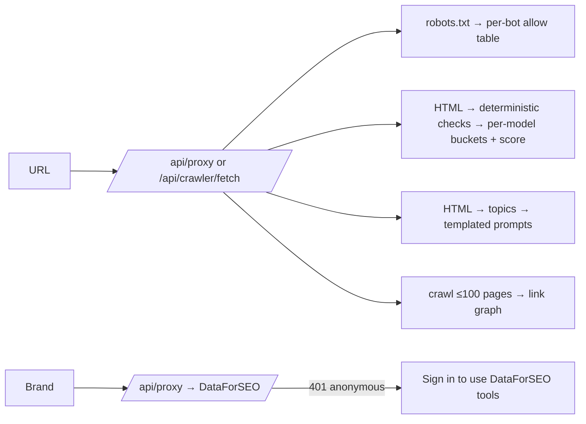

# Workflow: GEO / AI-search tools

**Reference URLs and features:**

- `/geo/ai-model-checker` (FEATURE-090)
- `/geo/ai-compatibility` (-091)
- `/geo/llms-generator` (-092)
- `/geo/brand-sentiment` (-093)
- `/geo/citation-flow` (-094)
- `/geo/competitor-research` (-095)
- `/geo/internal-links` (-096)
- `/geo/prompt-tracking` (-097)

**User objective:** check and improve how AI crawlers and answer engines can access, parse and cite a site.
**Shared UI (observed):** an indigo gradient hero with a title and a "badge" chip, a white input card on the right with a solid indigo button, a white results card below, and **New Analysis** to reset. Every action button is **disabled until input is entered**.

## A. AI Model Index Checker (observed, PASS)

1. Textarea: "One URL per line. Maximum 100 URLs supported."
2. **Analyze** fetches `/robots.txt` through `/api/proxy` (200) and renders in about 3 s.
3. Results: "1 URL(s) analyzed", then a table **AI Bot / Crawler · Status · HTTP Code · Details**. Seven rows: Google-Extended (Gemini), ChatGPT-User, GPTBot, CCBot, anthropic-ai, ClaudeBot, PerplexityBot. For example.com every row was `Allowed · 404 · Allowed (no matching rule)`. The 404 is the HTTP status of example.com's robots.txt.
4. Malformed `not a url ::` → "Invalid URL format" for that row (PASS).

**Inferred algorithm:** fetch robots.txt, find the group matching each UA (falling back to `*`), and evaluate Allow/Disallow for the path. A missing robots.txt (404) means allowed.

## B. AI Compatibility Checker (observed; malformed input = FAIL)

1. URL → **Start Analysis**. It calls `/api/proxy` (200) and `/api/deepseek` (401, "Missing Firebase auth token"). The deterministic checks still run.
2. Output: an overall score (example.com: **20**, "Needs Work") and "Model Performance" cards for 6 models (ChatGPT, Gemini, Mistral, Cohere, Claude, Llama) with a % and a label. "Detailed Compatibility Checks" has **5 checks per model** and an All/Passed/Failed filter. Examples:
   - ChatGPT: E-E-A-T Signals, Content Structure & Hierarchy, Semantic Richness, Clarity & Readability, Structured Data
   - Gemini: E-E-A-T Compliance, Conversational Query Optimization, Content Freshness, Technical SEO Foundation, Multimodal
   - Cohere: Embedding-friendly structure, Chunking suitability, Semantic clarity, Retrieval optimisation, Reranking quality
   - Claude: Ethical content, Safety, Verifiable claims, Professional communication, Long-context navigation
   - Each check shows its measured value, e.g. "Average sentence length is 12.5 words" or "0 heading(s); no lists found".
3. **Defect observed:** the malformed input `not a url ::` was analysed as `https://not a url ::` and produced a score of 13 with no validation error (TEST row status FAIL).

**Interpretation:** the "per-model" checks are the same page heuristics relabelled per model. Nothing is queried from the AI vendors. The weighting is **unknown** (U-03).

## C. LLMs.txt Generator (observed: first step)

1. Mode: **Crawl Website** | **Use Sitemap**. Enter the website URL, then **Start Extraction** (proxy 200).
2. Result: "Extracted URLs (1) · example.com · https://example.com" and a **Generate LLMs.txt** button. The generation step was not exercised (**not verified**).

## D. Owned-Content Sentiment (observed, PASS)

URL → **Analyze page tone** (`/api/crawler/fetch` 200). Output: Tone **Neutral**, Tone score **50/100**, positive and negative signal lists, then on-page checks (descriptive title, single H1, meta description, indexable, canonical, answer-ready depth "25 visible words", section structure, question coverage, image alt, social metadata "5 core Open Graph fields missing"), then numbered "Evidence-based next steps". The page copy states it "does not pretend to query external AI models".

## E. Competitor GEO Research (observed, PASS)

Two URL fields plus **Add competitor**, then **Analyze competitors**. Output table: **Site · GEO score · Words · Headings · Internal links · Topics · Status**. Results: example.com scored 20 (25 words, 0 headings, 0 links); iana.org scored 60 (67 words, 3 headings, 23 links). The footnote reads "Scores use the same ten deterministic checks for every fetched page." Submitting with the second field empty → "Enter your site and at least one competitor URL" (PASS).

## F. Internal Links Crawl (observed, PASS)

URL → **Start crawl** ("Crawl up to 100 real pages"). Output: crawl timestamp, Pages crawled (1), Internal links, Orphan pages, Linking score 100%, "Maximum depth 0; average 0 outbound internal links per page", tabs All pages / Orphan pages / Errors, and per page: title, URL, HTTP 200, depth, in/out counts. Export CSV.

## G. Prompt Opportunity Finder (observed, PASS)

URL → **Extract prompt opportunities**. Output: EXTRACTED TOPICS (trigram phrases), FETCHED PAGE TEXT, then "Predicted prompt opportunities" with the disclaimer "content-planning suggestions derived from the fetched page, not claims about current AI rankings". Prompts are templated ("What is {topic}…").

## H. AI Citation Flow (observed: gated)

Brand or domain, engine (Google AI Overview / ChatGPT), country → **Search citations**. Anonymous → `/api/proxy` 401 and **"Sign in to use DataForSEO tools"** (BLOCKED). The data source is stated as "live DataForSEO LLM Mentions data".

## Development implications

- A, D, E, F and G are cheap, deterministic and valuable. Build them on our crawler and analyzers (Phases B and C), and keep the honest disclaimers. They are good trust signals.
- B: build it, but **validate the input** and publish which checks feed each "model". Better still, present it as one "AI-readiness" score rather than pretending to model vendor-specific behaviour.
- H: needs a licensed LLM-mentions provider (DR-2).
