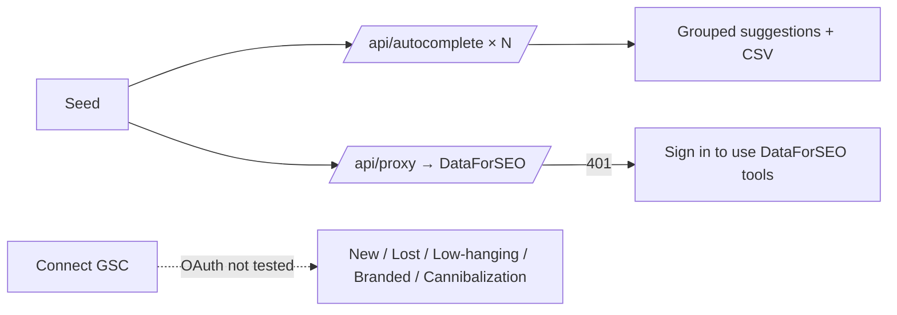

# Workflow: Keyword research family

**Reference URLs:**

- `/keywords/suggest` (FEATURE-060)
- `/keywords/ubersuggest` (-061)
- `/keywords/research` (-062)
- `/keywords/{new,lost,low-hanging,branded,cannibalization}` (-063)

**User objective:** find keyword ideas and opportunities.

## A. Keyword Suggest (observed, PASS)

1. Inputs: BASE KEYWORD (placeholder "Enter your seed keyword, e.g. pakistan") and COUNTRY (US, UK, Pakistan, India, Canada, Australia, Germany, France, Spain, Brazil). **Generate Suggestions** is disabled until a seed is typed.
2. It issues many `GET /api/autocomplete` calls (all 200). **Inferred:** seed + seed+A…Z + seed+0…9, which the "A-Z and 0-9 variations" copy supports.
3. Result in about 4 s: "Suggested Keywords (15)" for the seed, then grouped **A-Z Letter Variations** (`+A`: semantic seo agency, automation, analysis, audit…) and the digit groups. Actions: **Copy All**, **Export CSV**. A "How It Works" panel is included.
4. There is no URL validation, by design: `not a url ::` produced 12 autocomplete suggestions. That is correct for a keyword tool (counted as PASS).

## B. Ubersuggest-style modifiers (observed, PASS)

Keyword + country → **Search**. Output: counts by category (Questions 37 · Prepositions 100 · Comparisons 45), tabs **Visualization | Data**, **Copy Category**, **Export CSV**, and per-modifier groups (who/what/where/when/why/how/can/are/is/which…), each with "N keywords" or "No suggestions". Footer: "182 keyword ideas fetched from Google autocomplete."

## C. Keyword Research (observed: gated)

Tabs **Seed Keyword | Domain**, COUNTRY, LANGUAGE ("EN Auto") → **Search**. Anonymous → `/api/proxy` 401 and **"Sign in to use DataForSEO tools"**, with an empty table whose columns are **KEYWORD · VOLUME · CPC · COMPETITION · TREND** and actions Copy Keywords / Export CSV (BLOCKED). The copy says "DataForSEO Google Ads data".

## D. GSC keyword reports (observed: integration gate)

Each report page shows a **Connect Google Search Console** card ("needs readonly Search Console access to fetch keyword clicks, impressions, positions, and page data"). Report definitions (observed copy):

| Report | Definition shown |
|---|---|
| New | Keywords your site started ranking for in the current period |
| Lost | Keywords your site ranked for previously but no longer ranks for |
| Low-hanging | Keywords ranking around page 1–3 that are close enough to optimise |
| Branded | Queries containing your brand name |
| Cannibalization | Queries where multiple URLs compete for the same ranking opportunity |

The connect flow was **not started** (OAuth, outward-facing).

## Development implications

- Suggest and Ubersuggest call Google autocomplete through a server proxy. Using an unofficial endpoint at scale breaches Google's terms (R-05). Use a licensed autocomplete/SERP API, or the DataForSEO Keywords "autocomplete" endpoints (DR-2).
- The GSC reports need only GSC Search Analytics plus period diffs. Specs: [../agent-implementation-specs/SPEC-08-gsc-keyword-reports.md](../agent-implementation-specs/SPEC-08-gsc-keyword-reports.md).
- Our existing site already targets FR/EN/AR audiences, so add `hl`/`gl` language and country parameters from day one.
